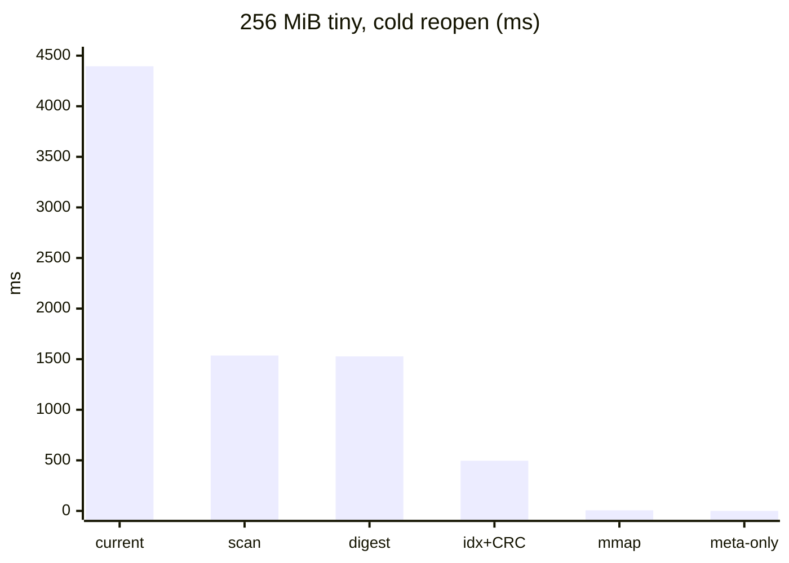
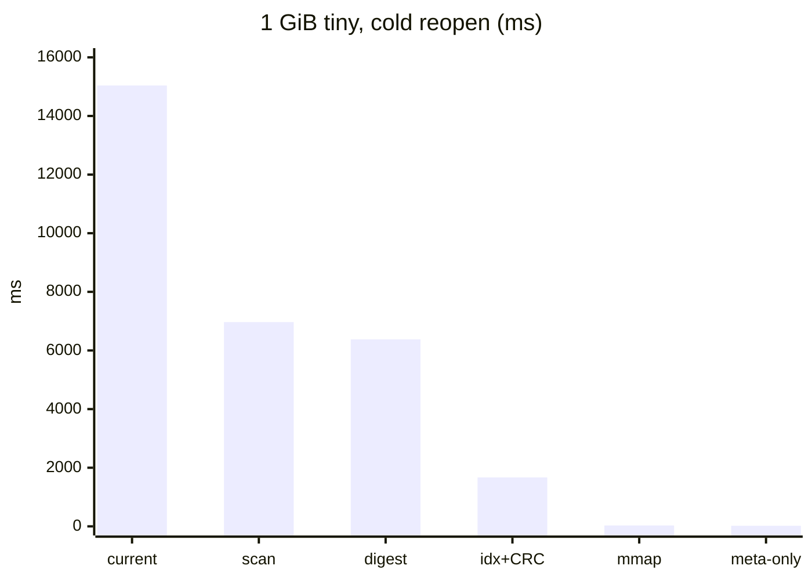

# Sealed-pack reopen and index artifacts: measurements

Harness: `benches/index_artifacts.rs` (measurement only). Reproduction of the large-store bug: `benches/big_reopen_repro.rs`.
Machine: Linux 6.18, LUKS disk, 31 GiB RAM of which only ~3 GiB was page cache during the 1 GiB runs (see caveats). Cold = `sync` then `vmtouch -e` on the store directory before each timed step.
Command: `MTXDB_IA_MIB=<256|1024> MTXDB_IA_FRAMES=tiny,mixed MTXDB_IA_LOOKUPS=100000 cargo +1.90.0 bench --manifest-path benches/Cargo.toml --bench index_artifacts`.
One run per cell, no repetitions: treat differences under ~20% as noise.

## 0. A bug found on the way (fixed in `ffa3ce2`, `76f332b`)

The first 1 GiB run failed its own correctness check: after reopening a 17.6M-record store, `store.get` missed 58% of the records written.

- **Cause:** the table-full threshold was `capacity.wrapping_mul(load_factor_percent) / 100` in `u32`. At 2^26 slots and 75% the product wraps and the threshold fell from 50,331,648 to **7,381,975** entries.
- **Why 17.6M triggered it:** the startup full scan sizes its table as `next_power_of_two(2 × records)`, which reaches 2^26 once records exceed 2^24 = 16.7M. 640 MiB (11M records) stayed at 2^25 and passed.
- **Why it was silent:** the full-scan builder discarded the `index.insert` error, so the open published an index holding only the first 7,381,975 records. Every later record (from offset 450,304,571) was unreadable although the pack held it.
- **Evidence:** forcing the full-scan path (`MTXDB_BR_DROP_CHECKPOINT=1`) reported `dropped 10220283 of 17602258 scanned records (first at offset 450304571: index table too full); indexed 7381975`. After the fix the same run finds every probed record (17,656 probes, 0 misses, 20–24 s open).
- **Fix:** the threshold is computed in `u64` (`max_occupied`), and every rebuild/growth path (`init_collection_from_scan`, `build_index`, `rebuild_index`, three post-growth retries) now fails with a `Corrupt` error naming the shard and offset instead of dropping the record.
- **Not explained:** why the first 1 GiB run fell to `FullScan` at all. A clean build, repeated reopen/evict cycles, and a foreign file in the directory all stayed on the `Checkpoint` path, and the fixed 1 GiB rerun below also stayed on it.

## 1. Question

Can a sealed pack reopen without reading the whole pack, and what does that save against today's checkpoint + recovery open? Secondary: how do a sorted immutable `.idx` and the current hash checkpoint compare in size and lookup cost?

## 2. What was compared

| Strategy | What it does at reopen | Reads the pack? |
|---|---|---|
| **current** | `PackfileStorage::open`: decode checkpoint, materialize the hash index, validate every frame (pack recovery) | all of it |
| **scan rebuild** | `scan_and_recover_packfile`: walk and CRC every frame | all of it |
| **`.idx` read + CRC** | read the sorted index file and verify its CRC | no |
| **trusted, mmap** | stat pack, mmap `.idx`, check header only | no |
| **trusted, metadata-only** | stat pack against a manifest length, read `.idx` header + fanout (1040 B) | no |
| **digest-verify** | read the whole pack and CRC it (what verifying a seal digest costs) | all of it |

Prototype `.idx`: 16-byte header (magic, count), `fanout[256]` u32, sorted 16-byte ids, u32 offsets, CRC32 trailer. One collection, ids = frame hashes. 20 bytes/entry plus ~1 KiB.

Workloads (one pack each; the harness asserts exactly one pack): **tiny** = 16-byte payloads, 61 B/frame, index-heavy. **mixed** = incompressible 1–64 KiB payloads, ~32 KiB/frame, pack-I/O-heavy. Ids are hash-spread.

## 3. Reopen time, milliseconds

### 3.1 256 MiB, tiny frames (4,400,515 records)

| Strategy | Warm | Cold |
|---|---:|---:|
| current open | 3075 | 4395 |
| scan rebuild | 487 | 1536 |
| digest-verify | 140 | 1527 |
| `.idx` read + CRC | 18–41 | 496–519 |
| trusted, mmap | 0.02 | 6.1 |
| trusted, metadata-only | 0.02 | 0.40 |



### 3.2 256 MiB, mixed frames (8,149 records)

| Strategy | Warm | Cold |
|---|---:|---:|
| current open | 111 | 1527 |
| scan rebuild | 43 | 1517 |
| digest-verify | 72 | 1650 |
| `.idx` read + CRC | 0.1 | 1.3 |
| trusted, mmap | 0.02 | 1.2 |
| trusted, metadata-only | 0.01 | 0.5 |

### 3.3 1 GiB, tiny frames (17,602,258 records, quiet machine)

| Strategy | "Warm" | Cold |
|---|---:|---:|
| current open (via Checkpoint) | 13,566 | 15,039 |
| scan rebuild | 6,605 | 6,968 |
| digest-verify | 5,368 | 6,378 |
| `.idx` read + CRC | 1,673 | 1,668 |
| trusted, read + CRC | 759 | 1,669 |
| trusted, mmap | 0.04 | 28.7 |
| trusted, metadata-only | 9.3 | 20.5 |



Current-open phases at 1 GiB (warm): pack recovery 5.4 s, checkpoint decode 4.2 s, index materialization 2.8 s.

### 3.4 1 GiB, mixed frames (32,832 records, 1018 MiB)

| Strategy | "Warm" | Cold |
|---|---:|---:|
| current open (via Checkpoint) | 199 | 6,208 |
| scan rebuild | 167 | 6,210 |
| digest-verify | 268 | 6,301 |
| `.idx` read + CRC | 0.2 | 1.7 |
| trusted, mmap | 0.03 | 1.7 |
| trusted, metadata-only | 0.01 | 0.9 |

With large frames the whole cold cost is reading 1 GiB (about 6 s at ~165 MiB/s on this disk). The index is 1.5 MiB and irrelevant.

## 4. Sizes

| | 256 MiB tiny | 1 GiB tiny | 1 GiB mixed |
|---|---:|---:|---:|
| pack | 256 MiB | 1024 MiB | 1018 MiB |
| entries | 4.40M | 17.60M | 32,832 |
| sorted `.idx` | 83.9 MiB | 335.7 MiB | 0.63 MiB |
| `index.checkpoint` | n/a (not itemized) | 768.0 MiB | 1.50 MiB |
| index delta log | n/a | 59.6 MiB | none |
| checkpoint bytes/entry | n/a | 45.8 | 48 |

```
Bytes per entry, 1 GiB tiny
checkpoint + delta  ##############################  47.0   (828 MiB / 17.6M)
checkpoint alone    ############################    45.8
sorted .idx         ############                    20.0
```

The `.idx` is 2.3× smaller than the checkpoint alone and 2.5× smaller than checkpoint + delta log. The 768 MiB checkpoint is the 2^25-slot table (33.5M × 24 B) at 52% load; the power-of-two rounding is where the waste is.

## 5. Build cost of the `.idx` (seal-time)

| | 256 MiB tiny | 1 GiB tiny | 1 GiB mixed |
|---|---:|---:|---:|
| sort alone | 402 ms | 1,530 ms | 2 ms |
| build + write + fsync | 988 ms | 3,467 ms | 38 ms |

About 87 ns/entry to sort, ~200 ns/entry end to end.

## 6. Lookups

### 6.1 Locator only, resident (100k random keys)

| | 256 MiB tiny | 1 GiB tiny | 1 GiB mixed |
|---|---:|---:|---:|
| sorted `.idx`, heap | 323 ns | 439 ns | 74 ns |
| sorted batch (100k sorted keys) | 11.1 ms | 51.2 ms | 0.7 ms |
| `.idx` via mmap (just mapped) | 308 ns | 18,246 ns | 74 ns |

The mapped 1 GiB figure includes minor page faults populating the mapping (336 MiB, ~86k pages) and is not a steady-state locator cost; the heap number is. No hash-locator-only number exists (no index-only API); the hash side is only measurable end to end.

### 6.2 End to end (key → decoded frame)

| | 256 MiB tiny | 1 GiB tiny | 1 GiB mixed |
|---|---:|---:|---:|
| `store.get` | 685 ns | 75,061 ns* | 3,705 ns |
| `.idx` locate + naive `pread` | 1,921 ns | 1,270,884 ns* | 13,877 ns |

\*The 1 GiB tiny rows are dominated by disk reads because the pack no longer fit in the ~3 GiB of page cache that was available; they measure the disk, not the indexes. The `.idx` end-to-end path is slower than `store.get` because of my untuned read path (plain `pread`, 4 KiB then 72 KiB retry), not the locator. These rows must not be read as "hash beats sorted".

### 6.3 Cold mmap first-touch

First 1000 random lookups on a freshly mapped, evicted `.idx`: 612 ms (256 MiB tiny, 84 MiB index), **2,048 ms** (1 GiB tiny, 336 MiB index), 0.1 ms (mixed). That is 0.6 ms and 2.0 ms per lookup: each binary-search step faults a page. mmap makes reopen nearly free but moves the cost into the first lookups; read + CRC pays it up front (1.7 s at 1 GiB) instead.

## 7. Conclusions

1. **The big win is not reading the pack at reopen.** 256 MiB tiny cold: 4.4 s → 0.4 ms. 1 GiB tiny cold: 15.0 s → 20 ms. 1 GiB mixed cold: 6.2 s → 0.9 ms. Verifying a digest at reopen is not a skip: it costs as much as the scan (5–6 s at 1 GiB).
2. **It scales linearly with pack size, the trusted path does not.** Current open went 3.1 s → 13.6 s warm from 256 MiB to 1 GiB (4× data, 4.4×); trusted metadata-only stayed in the tens of milliseconds.
3. **For tiny frames the index also costs.** At 1 GiB, 4.2 s of checkpoint decode and 2.8 s of materialization sit on top of 5.4 s of recovery. A scan rebuild alone (6.6 s) beats the current open (13.6 s).
4. **The `.idx` is 2.3× smaller than the checkpoint** (20 vs ~46 B/entry), immutable, and needs no delta/undo machinery for a sealed pack.
5. **Locator lookups cost ~0.3–0.4 µs (O(log n), cache-miss bound)** at 4–18M entries. Not a bottleneck next to frame reads.
6. **mmap versus read+CRC is a trade:** ~0 ms reopen but 2 ms per cold first-touch lookup at 1 GiB, versus 1.7 s up front then all warm. A hybrid (pre-touch the fanout and upper levels) is worth evaluating.

## 8. Caveats

- **The 1 GiB "warm" numbers are not fully warm.** Only ~3 GiB of the 31 GiB RAM was page cache (the rest in use by other processes), so a 1 GiB pack plus 768 MiB checkpoint plus `.idx` did not stay resident. That is why the 1 GiB "warm" scan (6.6 s) is close to cold (7.0 s) and `store.get` at 1 GiB tiny is disk-bound. The 256 MiB warm numbers, which fit in cache, are the reliable warm figures.
- An earlier 1 GiB run was contaminated by tests running concurrently and is discarded; the rerun above is on an otherwise idle machine.
- **Safety is not measured.** Trusting a sealed pack needs a seal protocol (pack fsync, manifest and `.idx` via tmp + fsync + rename, directory fsync) and a crash-injection test. The trusted-reopen numbers are a lower bound on cost, not a correctness result. A metadata-only reopen also does not detect corruption inside the pack; that needs lazy per-frame CRC, background scrub, or an explicit verify command.
- Single collection, no overwrites, no multi-pack newest-wins (MIDX) resolution. The memtable + runs design for indexes larger than RAM is unmeasured.

## 9. Recommendation

Keep the mutable hash index and delta log for the active pack. Prototype separately: (1) the seal protocol with trusted reopen and a crash-injection test, which is where the 6–15 s goes; (2) the per-pack sorted `.idx` written at seal, mmap'd, for compactness and bounded RAM. Keep them on separate branches.
